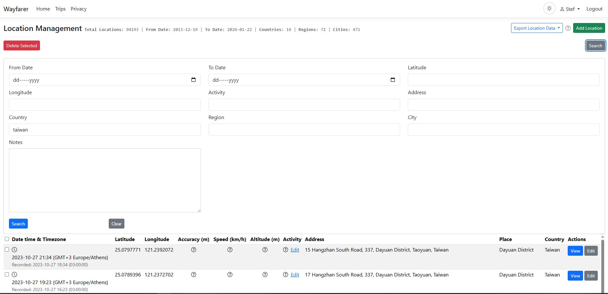
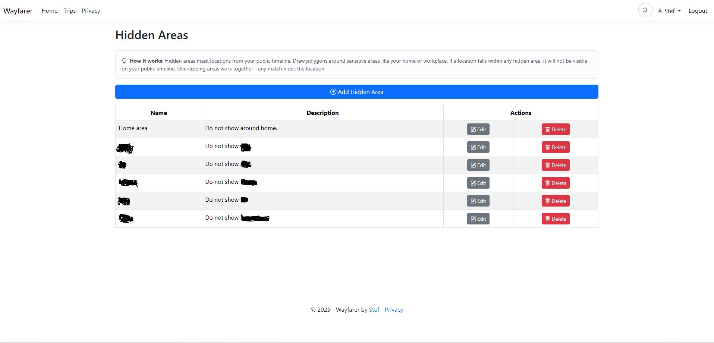

# Timeline and locations

Use your Timeline to explore where you have been, correct individual records and
choose what to share publicly. Each **Location** is one recorded position at a
particular time. Locations can come from WayfarerMobile tracking, GPSLogger,
compatible apps, manual check-ins, files or entries you add in the web app.
See [Connect apps](connect-apps.md) to set up live capture from an app.

Trips are plans rather than history. To plan destinations and record visits to
them, use the [Trips guide](trips.md).

## Browse your history

Open your name menu and choose the view that fits your task:

- **Timeline**: explore a day, month or year of recorded history.
- **My Private Timeline**: explore your own history on the map.
- **Locations**: work with a map and table together.
- **All Locations**: search the table, edit records and export history.

In **Timeline**, choose day, month or year to change the scale. Use the previous
and next controls to move through days, months and years, or select a date, month
or year directly to revisit a journey. Choose **Today** to return to the current
date. These are calendar-period views; use Locations search below for an arbitrary
start and end date.

Pan and zoom to explore, then select a marker or table row for its details. Large
map views can show a sample of locations to remain readable; use the table and
filters when you need to find a particular record.

### Search and filter locations

Open **Search** in the Locations table. Combine a date range with activity,
address, country, region, city or text in notes. Latitude and longitude fields help
find records around a position. Choose **Search** to apply the filters and
**Clear** to remove them.

Locations retain their recorded time and local-time information when available.
Check the displayed timezone when comparing a phone record with a web record,
especially across travel or daylight-saving changes.

## Add or correct a location

1. Open **All Locations** and choose **Add Location**, or choose **Edit** for an
   existing record.
2. Set the coordinates and timestamp. Choose an activity and add notes if useful.
3. Review the address fields and save.

You can also change an activity from the location details or table without opening
the full form. Choose Save in the inline editor to apply the selected activity.

Saves compare the fields you originally observed. A conflicting change keeps your
draft; independent fields can still save. If a reply is lost, Save checks the
retained attempt before submitting another action. A successful save completes
normally. Keep this browser's saved site data while recovering a draft. If local
storage fails, the page reports that it could not save the draft; keep it open.
Conflict review shows your originals, draft and current facts before you explicitly
adopt new originals. An old receipt cannot consume newer typing, toolbar Clear,
image insertion or a map pick. These changes are retained before you press Save.
Reopening an unresolved inline Activity edit restores your desired selection;
after success, a later edit starts from fresh originals.

Moving a point preserves the exact capture instant and updates the local display
for the new zone. Explicit time editing uses the zone shown when the form opened;
the draft keeps that zone and its chosen daylight-saving occurrence across reloads,
even if another writer moves the point. Choose an occurrence for an ambiguous
daylight-saving time. If a retained draft says its time zone is unavailable,
review or re-enter **Local Date and Time**, choose the earlier/later occurrence
when needed, and enter the intended zone (for example, `Europe/Athens` or `UTC`).
Choose **Review time and zone** and confirm the displayed local time, zone and UTC
instant. Confirmation retains this interpretation before Save; earlier uncertain
actions still need recovery. Cancel keeps the retained draft and sends nothing.
If you have not changed the time, you can save Notes and other fields without
confirming a zone. Moving also discards
obsolete address information and attempts one authorized replacement. Optional
lookup failure still saves valid coordinates. Explicit manual components, including
Clear, win over lookup results. Manual-only address editing makes no provider call.

A per-record delete confirms observed stored content. Changed content conflicts;
damaged/unavailable display facts remain visible and do not make the row undeletable.
After rejection, opening Delete again shows previously observed and current content
for a new confirmation. A pending action keeps its original consent; reopening the
confirmation cannot authorize deleting changed content while it might still execute.

Use **Bulk Edit Notes** for deliberate changes across matching records. Matching
and append use current locked values at Apply time; preview counts can change.
Replace and Clear overwrite current Notes. Selected bulk deletion removes current
owned rows even if their content changed, including when you select one row. A
lost bulk reply is uncertain: refresh history and decide deliberately before
submitting again. There is no automatic replay; append may duplicate a suffix.
Export history you need to keep before deleting.

Server execution authority and historical receipts are finite evidence. They
never expire phone captures, drafts or pending obligations. Companion mobile
source/native delivery remains separately owned.

### Read location details

Details can include activity, notes, coordinates, address, accuracy, speed,
altitude, heading and source. Missing metadata means it was not available in that
record; it does not imply a zero value.

Some enriched locations show structured address components and a separate
**Nearby mapped feature**, **Mapped area** or **Mapped feature**. A nearby business
or building is context, not proof that you visited it. **Street address
unavailable** or **Address details unavailable** means the lookup did not supply
that detail; retained provider display text may still be shown.

The **Wiki** action looks for related Wikipedia articles. Opening an article
contacts Wikipedia. Optional address lookup and repair are explained in
[Personal location providers](location-providers.md#address-enrichment-controls).

## Understand your statistics

Timeline summaries show the number of locations, the first and last dates and
recorded countries, regions and settlements. Select **Countries**, **Regions** or
**Cities** in the summary to open geographic details. Expand **Country → Region
→ city/settlement** to see record counts and first/last recorded dates. A **Map**
action returns you to that geography on the map. Counts measure recorded positions,
not confirmed visits to venues; use [Trip visits](trips.md#record-and-review-visits)
for the separate planned-Place workflow.

Geographic counts depend on the address labels saved with each location. Different
spellings can split the same place, and missing labels are not invented. **Country
not recorded** and **Region not recorded** group records with missing parent
labels; they do not count as additional countries or regions.

Your private views summarize their own history or the complete selected date
period, even when a large month/year map shows only sampled points. Public
Timeline summaries cover all history eligible for public viewing, including the
delay and Hidden Areas rules. Moving or zooming the public map does not change
that full-history summary. A public Timeline with no eligible locations has zero
counts and no first or last date.

## Make your Timeline public deliberately

Choose **Private** for no public Timeline, public **Now** to share without a delay,
or a delayed public Timeline to share only older locations. [Hidden Areas](#protect-sensitive-places-with-hidden-areas)
exclude sensitive positions independently of that delay.

Your Timeline starts private. To publish it:

1. Open **Settings > Manage Timeline Settings**.
2. Optionally set a title, then enable **Make Timeline Public**.
3. Choose a **Time Threshold** and save.
4. Open the public link shown in **Settings**, preferably while signed out, to
   check what a visitor can see.

The threshold is a delay: **1 day** shows locations at least a day old. First-time
public sharing defaults to a one-day delay if you have not chosen one. **Now**
shares without a delay and requires explicit confirmation that your current
location will be publicly available.

Presets include one hour, day, week, month and year. For a custom delay, use a
number and unit: `h` hours, `d` days, `w` weeks, `m` months or `y` years. For example,
`6h`, `2w` or `1.5d`. Month and year delays are approximations of 30 and 365 days.
If settings report an invalid saved threshold, choose and save a valid one before
expecting public sharing to work.

Public details can expose precise positions, times, addresses, activities and
notes. A delay reduces immediacy but still reveals history and routines. Making
the Timeline private again stops public access through Wayfarer; it cannot recall
copies somebody has already saved.

## Protect sensitive places with Hidden Areas

Open **Hidden Areas** from your name menu. Add a named area and draw a polygon
around a sensitive location such as home or work. Save it, then check the public
Timeline. Edit the polygon if you need a wider boundary.

Locations within Hidden Areas are excluded from the public Timeline, its embed
and its public statistics. Overlapping areas work together. Deleting a Hidden
Area makes those records eligible for public viewing again, subject to the delay.

Hidden Areas do not delete records from your private history. They do not prevent
capture or provider address lookup, hide locations in trusted Groups, or hide
Places and visit progress in a public Trip. Set those sharing choices separately.

## Share a link or embed the Timeline

When your Timeline is public, **Settings** shows its public link and offers **Copy
embed URL** and **Copy embed HTML**. Open Wayfarer at the public HTTPS address
people will use before copying. Paste the generated iframe into your website;
adjust its height to fit the page.

The embed follows the same public visibility rules. Ordinary wheel scrolling and
single-finger swipes scroll the surrounding page. Use Ctrl + wheel (Cmd on macOS)
to zoom, mouse drag to pan, or two fingers to pan and zoom on touchscreens. **Open
full view** opens the regular public Timeline in a new tab.

For a copy of your history or to add older records, see
[Import and export](import-export.md). For sharing with named people, see
[Groups](groups.md).

[User guide](index.md) · [Documentation home](../README.md)
